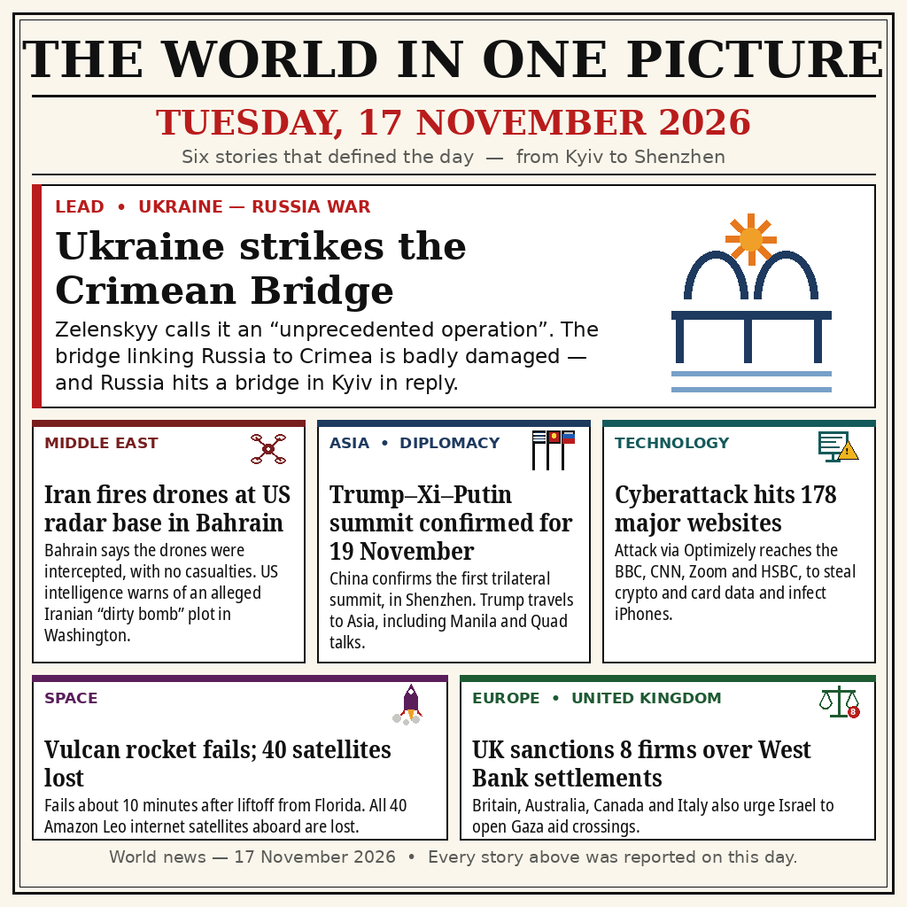

# The World in One Picture — make.fun bounty `news-image-20261117`

[](https://make.fun/bounty/news-image-20261117?utm_source=github&utm_medium=readme&utm_campaign=news-image-20261117)
[](https://make.fun/bounty/news-image-20261117/leaderboard?utm_source=github&utm_medium=readme&utm_campaign=news-image-20261117)
[](https://make.fun/bounty/news-image-20261117?utm_source=github&utm_medium=readme&utm_campaign=news-image-20261117)

A program that writes one image summing up the world's news of
**Tuesday, 17 November 2026** — built for the make.fun bounty
**"Sum up 17 November's world news in one image"** ($250, deadline
19 Nov 2026 00:00 UTC).



## The image

A newspaper front page, 1024×1024 px, drawn entirely with Python Pillow:
every word is rendered as real text (no AI-generated imagery, so no
garbled text) and every picture is a flat vector-style icon drawn with
PIL primitives.

| Story | Panel |
| --- | --- |
| **Lead — Ukraine strikes the Crimean Bridge.** Zelenskyy calls it an "unprecedented operation"; the bridge linking Russia to Crimea is badly damaged, and Russia hits a bridge in Kyiv in reply. | Lead, top |
| **Iran fires drones at a US radar base in Bahrain.** Bahrain says they were intercepted, no casualties or damage. US intelligence warns of an alleged Iranian "dirty bomb" plot in Washington (reported as an intelligence claim, not fact). | Middle East |
| **Trump–Xi–Putin summit confirmed for 19 November.** China confirms the first trilateral summit, in Shenzhen; Trump travels to Asia, including Manila and Quad talks. | Asia / Diplomacy |
| **Cyberattack hits 178 major websites.** Attack via Optimizely reaches the BBC, CNN, Zoom and HSBC, aiming to steal crypto and card data and infect iPhones. | Technology |
| **Vulcan rocket fails; 40 satellites lost.** The rocket fails about 10 minutes after liftoff from Florida; all 40 Amazon Leo internet satellites aboard are lost. | Space |
| **UK sanctions 8 firms over West Bank settlements.** Britain, Australia, Canada and Italy also urge Israel to open Gaza aid crossings. | Europe / UK |

## Layout

| Path | What it is |
| --- | --- |
| `main.py` | Entry point (Python 3.13, standard library only). Copies `asset/entry.png` to `/output/entry.png` (or `$MAKEFUN_OUTPUT_DIR/entry.png` outside the grader). Deterministic: two runs write byte-identical output. |
| `asset/entry.png` | The finished image, 1024×1024 px PNG, 138,339 bytes (limit 1 MiB). |
| `draw_news.py` | Build tool (not part of the graded entry): draws `asset/entry.png` with Pillow. It asserts that no panel's text overflows its box. |

## Verify locally

```sh
python3 draw_news.py asset/entry.png   # redraw the image
mkdir -p out && MAKEFUN_OUTPUT_DIR=out python3 main.py
python3 -c "from PIL import Image; im = Image.open('out/entry.png'); print(im.size)"
# run twice and compare sha256 — the bytes must be identical
```

## Status

Built and verified locally (see `AUDIT-v1.md` in the workspace, not
committed here): image 1024×1024, 138,339 bytes, `main.py` byte-identical
over two runs, kit check passed. **Not yet submitted** — submission is a
separate step by the coordinator.

---

Built for [make.fun — Sum up 17 November's world news in one image](https://make.fun/bounty/news-image-20261117).
